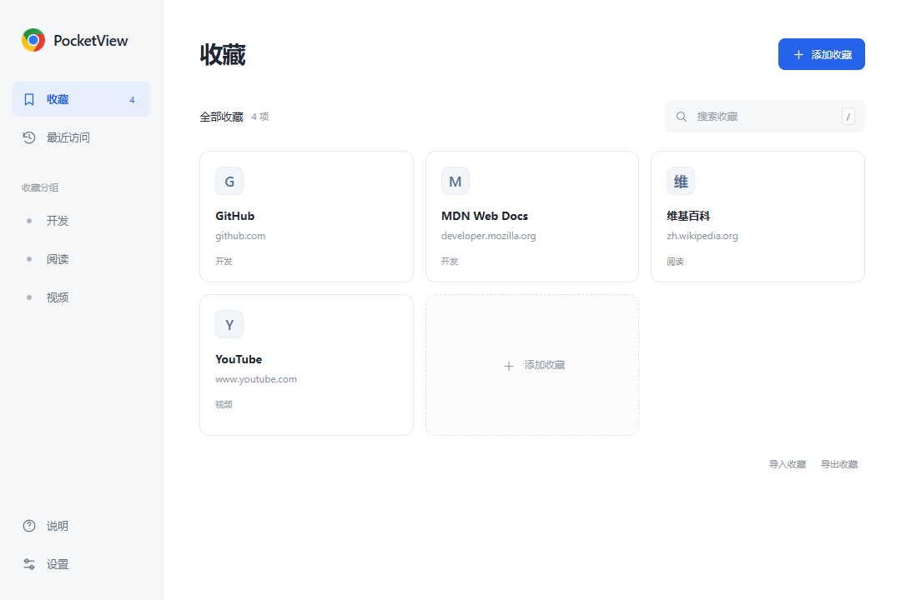
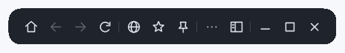
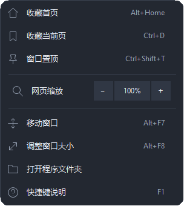
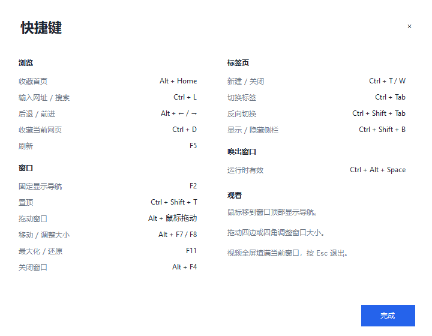

<div align="center">
  
  <h1>PocketView · 口袋视窗</h1>
  <p>Windows 便携无边框浏览器</p>
  <p>侧边标签页 · 本地收藏 · 悬浮导航 · 窗口内视频全屏</p>
  <p><a href="#界面">界面</a> · <a href="#开始使用">开始使用</a> · <a href="#快捷键">快捷键</a> · <a href="#数据与迁移">数据与迁移</a> · <a href="#开发与验证">开发与验证</a></p>
</div>

PocketView 用一个无边框窗口打开网页，适合阅读文字、查看资料和播放视频。导航在需要时出现，标签页放在侧边并可随时隐藏。首页是本地收藏卡片，收藏、设置和浏览数据都保存在程序目录中。

基于 **C#、WinForms 和 Microsoft WebView2**，面向 **Windows 10 / 11 x64**。原创代码采用 [MIT 许可证](LICENSE)。

## 界面



截图使用独立测试配置中的示例收藏，不包含个人浏览数据。

<table>
  <tr>
    <td align="center" width="50%"><strong>悬浮导航与更多菜单</strong></td>
    <td align="center" width="50%"><strong>快捷键说明</strong></td>
  </tr>
  <tr>
    <td align="center"><br></td>
    <td align="center"></td>
  </tr>
</table>

## 功能

| 功能 | 行为 |
| --- | --- |
| 无边框窗口 | 网页铺满窗口，支持拖动、四边和四角拉伸、最大化及置顶 |
| 悬浮导航 | 鼠标移到窗口顶部显示，移开后收起；`F2` 可固定显示 |
| 侧边标签 | 在一个主窗口中打开多个网页，侧栏可隐藏；切换时保留页面和输入状态 |
| 本地收藏 | 卡片列表、分组、搜索、编辑、删除、拖动排序及 JSON 导入导出 |
| 窗口内全屏 | 网页视频进入全屏时填满当前窗口，保持窗口位置和大小 |
| 网页缩放 | 在更多菜单中直接缩小、放大，点击百分比恢复为 `100%` |
| 本地记录 | 保存最近 500 条访问记录，下载默认放在程序的浏览数据目录 |
| 便携数据 | 收藏与浏览数据分目录，便于备份、迁移和清理 |

打开收藏保持当前窗口大小、位置、最大化、缩放和置顶状态。网页的新窗口链接与 `window.open` 在同一主窗口的新标签中打开。

## 开始使用

### 已有完整便携目录

1. 把整个 `app` 文件夹放到可写目录。
2. 双击其中的 `PocketView.exe`。
3. 在首页添加收藏，或按 `Ctrl+L` 输入网址。

复制到其他电脑时也要复制**整个 `app` 文件夹**，包括 DLL、`assets` 和 `runtime`。项目根目录的快捷方式只适用于创建它的电脑，不作为迁移入口。请先解压后运行。

### 从源码构建

本仓库不包含 EXE、DLL、固定版浏览器内核或个人数据。克隆后需要先构建：

```powershell
git clone https://github.com/lovelyxuxu/PocketView.git
cd PocketView
powershell -NoProfile -ExecutionPolicy Bypass -File .\tools\build.ps1
.\app\PocketView.exe
```

构建与运行条件：

| 项目 | 要求 |
| --- | --- |
| 操作系统 | Windows 10 / 11，x64 |
| .NET | .NET Framework 4.7.2 或更新版本 |
| 编译器 | 使用系统 .NET Framework 自带的 `csc.exe`，无需安装 Visual Studio |
| 构建依赖 | 首次构建从 NuGet 官方源恢复 WebView2 SDK `1.0.3179.45`，需要联网 |
| 网页内核 | 优先使用 `app/runtime` 中的固定内核；没有该目录时使用本机已安装的 WebView2 Runtime |

构建只恢复 SDK，**不会自动下载固定版内核**。如果本机没有 WebView2 Runtime，请先准备运行内核，再启动程序。

### 准备完整便携包

从微软获取 x64 WebView2 Fixed Version Runtime，解压到 `app/runtime`。内核目录中应包含 `msedgewebview2.exe`；允许保留解压后的版本子目录。

```text
app/
├─ PocketView.exe
├─ Microsoft.Web.WebView2.Core.dll
├─ Microsoft.Web.WebView2.WinForms.dll
├─ WebView2Loader.dll
├─ assets/
├─ runtime/
│  └─ <固定版内核目录>/
│     └─ msedgewebview2.exe
├─ 许可证/
└─ 使用说明.txt
```

随后复制整个 `app` 目录即可。内核来源和分发说明见 [THIRD-PARTY.md](THIRD-PARTY.md)。

## 常用操作

- **打开网页**：点击收藏卡片；或按 `Ctrl+L` 输入网址、搜索词。`example.com` 直接打开，普通文本使用 Google 搜索。
- **移动窗口**：拖动收藏首页空白区域、悬浮导航空白区域；在普通网页中按住 `Alt` 再拖动。
- **调整大小**：在正常窗口状态下拖动四边或四角，也可使用 `Alt+F8`。键盘调整时先按方向键选边，再移动鼠标或按方向键，`Enter` 确认。
- **切换标签**：显示侧边栏后点击标签，或使用 `Ctrl+Tab`。隐藏侧边栏不会关闭网页，页面会恢复全宽。
- **观看视频**：使用网页自身的全屏按钮。视频填满当前窗口，`Esc` 按网页正常行为退出。
- **查看说明**：首页侧栏「说明」、设置中的「快捷键说明」、更多菜单和 `F1` 打开同一面板。

## 快捷键

| 分类 | 快捷键 | 操作 |
| --- | --- | --- |
| 导航 | `F2` | 固定显示 / 收起悬浮导航 |
| 导航 | `Ctrl+L` | 输入网址或搜索 |
| 导航 | `Alt+Home` | 收藏首页 |
| 导航 | `Alt+←` / `Alt+→` | 后退 / 前进；无上一页时后退回收藏首页 |
| 导航 | `F5` | 刷新 |
| 收藏 | `Ctrl+D` | 收藏当前网页 |
| 收藏 | `/` | 在收藏首页聚焦搜索框 |
| 标签 | `Ctrl+T` | 新标签页 |
| 标签 | `Ctrl+W` | 关闭当前标签；最后一个标签关闭时退出 |
| 标签 | `Ctrl+Tab` / `Ctrl+Shift+Tab` | 切换到下一个 / 上一个标签 |
| 标签 | `Ctrl+Shift+B` | 显示 / 隐藏侧边标签栏 |
| 窗口 | `Ctrl+Shift+T` | 置顶 / 取消置顶 |
| 窗口 | `Ctrl+Alt+Space` | 程序运行时全局唤出主窗口，可在设置中关闭 |
| 窗口 | `Alt+鼠标拖动` | 拖动当前窗口 |
| 窗口 | `Alt+F7` / `Alt+F8` | 移动窗口 / 调整大小 |
| 窗口 | `F11` | 最大化 / 还原窗口 |
| 窗口 | `Alt+F4` | 关闭整个窗口 |
| 帮助 | `F1` | 快捷键说明 |

`Ctrl+Shift+T` 在 PocketView 中用于置顶。`F11` 控制窗口最大化，与视频的窗口内全屏是两个操作。

## 数据与迁移

应用管理的数据使用相对于 EXE 的路径，不依赖固定盘符或用户名。

```text
app/
├─ 个人数据/
│  ├─ 收藏.json       收藏、分组与排序
│  └─ 设置.json       软件设置与上次窗口位置、大小
└─ 浏览数据/
   ├─ 历史.json       最近 500 条访问记录
   ├─ 下载/           网页下载文件
   ├─ 运行.log        诊断日志
   └─ …               WebView2 的 Cookie、缓存和网站存储
```

**备份、删除或复制数据前，先关闭 PocketView，等待相关网页内核进程退出。**

| 目的 | 操作 |
| --- | --- |
| 在另一台电脑继续使用 | 复制整个 `app`，保留两个数据目录；登录是否仍有效由网站和系统决定 |
| 备份收藏和设置 | 备份「个人数据」目录，或从首页导出收藏 JSON |
| 分享程序和收藏 | 复制整个 `app`，从副本删除「浏览数据」；收藏名称和网址也可能包含私人信息 |
| 分享干净程序 | 从副本删除「个人数据」和「浏览数据」，下次运行会自动重建 |
| 更新程序 | 关闭程序，更新 EXE、DLL、`assets` 和内核，保留两个数据目录 |

JSON 数据采用临时文件与原子替换保存，`.bak` 保留上一次版本。读取失败时保留 `.damaged-*` 副本并在首页提示。

收藏、设置、浏览数据、固定内核、构建产物、快捷方式和工作目录均已通过 `.gitignore` 排除。

## 开发与验证

```text
src/
├─ BrowserWindow.cs       窗口、网页生命周期、导航与快捷键
├─ BrowserTabs.cs         标签页与侧边栏
├─ NavigationIsland.cs    悬浮导航绘制
├─ NavigationMenu.cs      更多菜单与缩放控件
├─ ResizeEdgeInput.cs     无可见边框的窗口边缘拉伸
├─ UiComponents.cs        通用控件与快捷键面板
├─ FavoriteDialog.cs      网页收藏编辑
├─ Store.cs               收藏、设置与历史持久化
└─ Verification.cs        隔离配置的页面与窗口集成检查
app/assets/               本地收藏首页与测试页面
app/许可证/               第三方组件许可
tools/
├─ build.ps1              构建程序，自动恢复缺失依赖
├─ restore-sdk.ps1        从 NuGet 恢复固定版本 SDK
├─ verify.ps1             数据层与集成检查入口
├─ StoreTests.cs          数据持久化检查
└─ create-icon.ps1        从保留的原始图标生成应用图标
docs/screenshots/        README 使用的界面截图
work/                     下载、构建与测试中间文件，不提交
```

编译前关闭运行中的程序：

```powershell
powershell -NoProfile -ExecutionPolicy Bypass -File .\tools\build.ps1
powershell -NoProfile -ExecutionPolicy Bypass -File .\tools\verify.ps1
```

验证使用 `work/verification-profile`，不写入真实收藏和浏览数据。报告生成于 `work/verification.txt`，界面渲染预览也保存在 `work`。检查覆盖本地收藏管理、标签切换、无边框布局、窗口内全屏、导航恢复、菜单缩放以及说明面板的反复开关。

集成检查目前校验固定内核 `157.0.4341.60`，运行前请配置对应版本。使用其他系统内核可以运行程序，但版本断言可能失败。内核升级时应同步调整验证基线。

## 常见情况

| 情况 | 处理方式 |
| --- | --- |
| 导航已隐藏，无法找到返回按钮 | 按 `F2` 固定显示导航，或按 `Alt+Home` 回首页 |
| 页面加载失败或长时间无响应 | 加载失败或超过 5 秒自动显示导航，可返回或回首页 |
| 无法拖动网页窗口 | 按住 `Alt` 拖动，或使用 `Alt+F7` |
| 四角不能拉伸 | 先退出最大化，再拖动边缘；也可使用 `Alt+F8` |
| Google 显示人机验证 | 按网页要求处理，或使用返回、首页离开；不影响本地导航按钮 |
| 唤出快捷键不起作用 | 在设置页检查是否启用及是否被其他软件占用 |
| 内核启动失败 | 检查 `runtime` 是否完整，或本机是否已安装 WebView2 Runtime；同时确认程序目录可写 |

## 当前边界

- 当前不恢复退出前的标签列表，下次启动进入收藏首页。
- 当前不提供 Chrome 扩展、广告拦截、账号同步或通用的阅读 / 播放进度恢复。
- 网站兼容性、视频编解码、DRM 和登录策略取决于具体网站与内核，仍需按使用场景验证。
- 完整便携运行已在本机验证，尚未在另一台实体电脑完成验收。

## 许可证

PocketView 原创代码和界面样式采用 [MIT 许可证](LICENSE)。欢迎使用、修改和分发，保留原许可证与版权声明即可。

MIT 许可不包含第三方组件、Google Chrome 原始图标及其衍生图标的权利授权；这些资源保留各自的许可、版权和商标要求。具体来源与说明见 [THIRD-PARTY.md](THIRD-PARTY.md)。本项目不由 Google 或 Microsoft 提供或背书。
